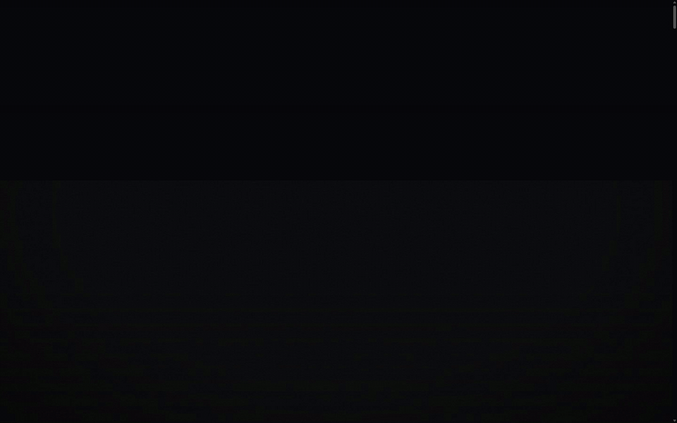
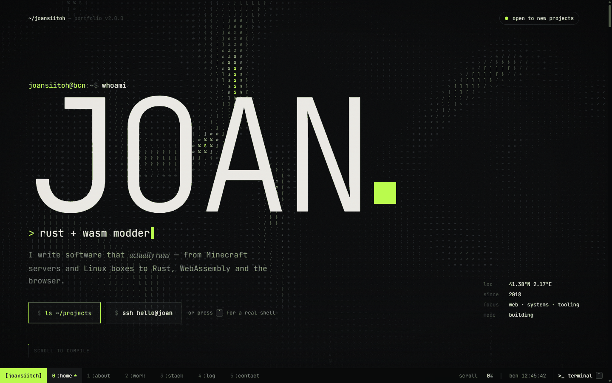
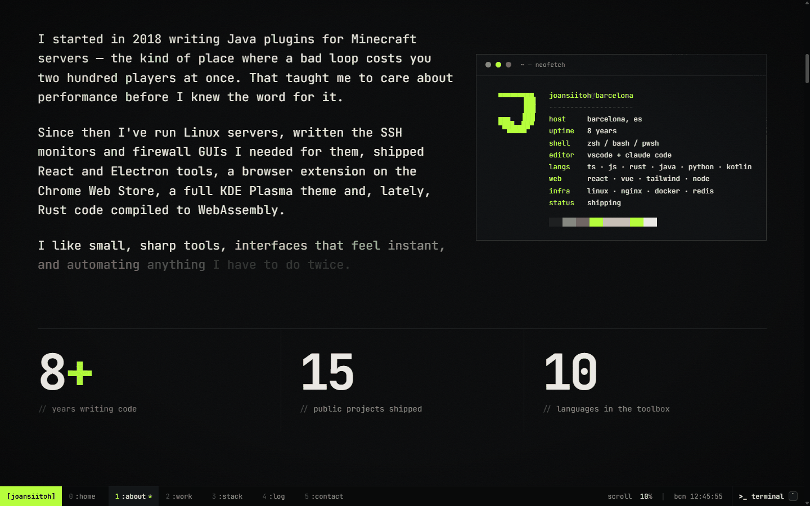
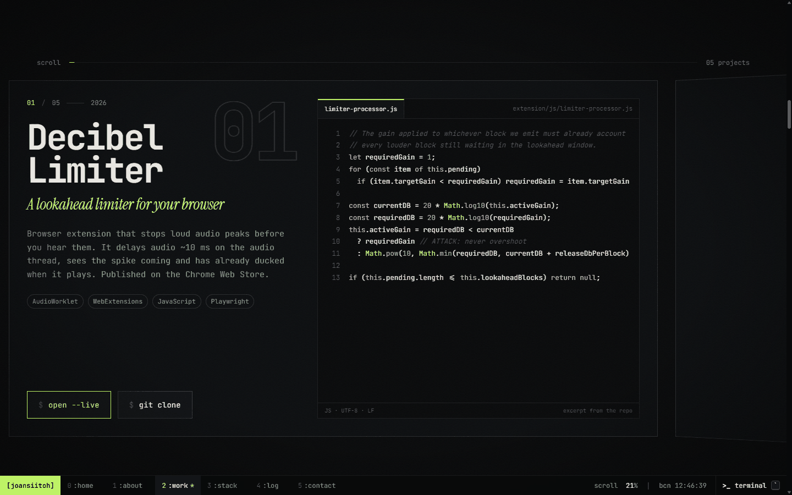
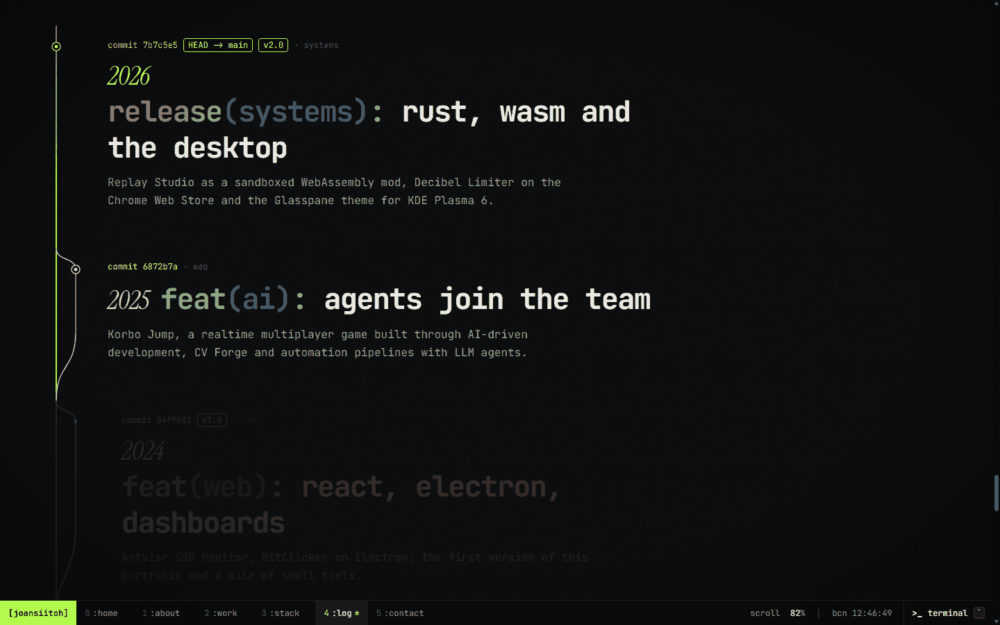
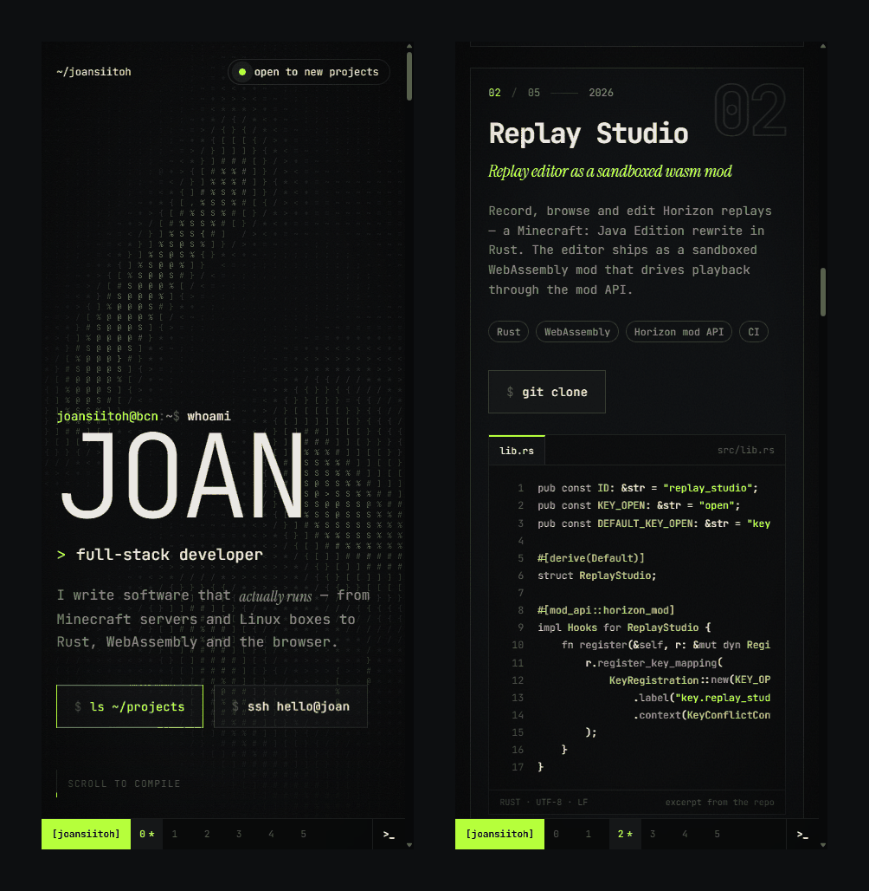
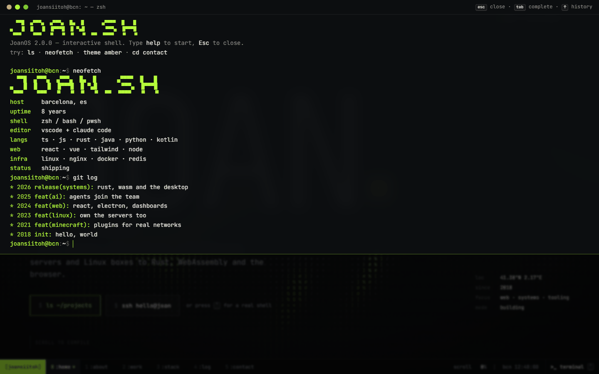

<div align="center">



# joan.sh

**An interactive developer portfolio that behaves like a machine you can use.**
It boots, it has a shell, and every section runs a command.

[**Live demo**](https://joansitoh.github.io/developer-portafolio/) ·
[Features](#features) ·
[Terminal](#the-terminal) ·
[Make it yours](#make-it-yours) ·
[Run it locally](#getting-started)


</div>

---

## Overview

Most developer portfolios are a hero, a grid of cards and a contact form. This one leans into
what developers actually live in: a terminal, a status line, an editor and `git log`.

- A **kernel-style boot log** wipes away into the hero.
- A hand-written **WebGL2 shader** renders a living field of ASCII glyphs behind it.
- You get around with a **tmux-style status bar**, and every section opens with the shell
  command that "prints" it.
- Projects show **real code taken from their repositories**, typed into an editor pane.
- A real **interactive shell** is always one key away: press <kbd>`</kbd>.

Every line of copy, every project and every terminal answer comes from one typed file,
[`src/content/profile.ts`](src/content/profile.ts).

## Features

<table>
<tr>
<td width="50%" valign="top">

### Hero & ASCII field
The background is a fragment shader that turns domain-warped simplex noise into monospace
glyphs, sampled from a font atlas generated at runtime with the site's own font. The cursor
bends the field with a ripple and a few columns fall like `tail -f`. The name uses the
variable font's weight axis, so letters get heavier as the cursor gets close, and the role
line decodes through random glyphs.

</td>
<td width="50%"></td>
</tr>
<tr>
<td width="50%"></td>
<td width="50%" valign="top">

### `cat about.md`
Paragraphs light up word by word as you read, scrubbed to the scroll position. Next to them
sits a `neofetch` card that "runs" when it comes into view, followed by animated counters.

</td>
</tr>
<tr>
<td width="50%" valign="top">

### `ls ~/projects`
On desktop the section pins and the projects scroll sideways, each panel settling in 3D as it
reaches the centre. Every project is a window with an editor pane showing an **excerpt from
its real repository** that types itself in, with a tiny dependency-free syntax highlighter.
Older work follows as an `ls -la ~/archive` listing.

</td>
<td width="50%"></td>
</tr>
<tr>
<td width="50%"></td>
<td width="50%" valign="top">

### `git log --graph`
Career history as commits on branches (`minecraft`, `sysadmin`, `web`, `systems`). The graph
draws itself as you scroll and each commit node pops in as the line reaches it.

Also in the page: `tree ~/stack` printed line by line with marquees that react to scroll
velocity, and an **`ssh` contact session** that asks three questions and opens your mail
client with everything filled in.

</td>
</tr>
</table>

### Mobile

The horizontal scroll becomes a vertical stack of cards, the shader drops its intensity and
density, and the custom cursor stays off on touch devices.

<p align="center"></p>

## The terminal

Press <kbd>`</kbd> (or <kbd>Ctrl</kbd>/<kbd>⌘</kbd> + <kbd>K</kbd>) anywhere to drop down a
Quake-style shell. It has command history (<kbd>↑</kbd>/<kbd>↓</kbd>), <kbd>Tab</kbd>
completion for commands and arguments, and <kbd>Ctrl</kbd>+<kbd>L</kbd> to clear.

<p align="center"></p>

| Command | What it does |
| --- | --- |
| `help` | List every command |
| `whoami` · `cat about.md` | Who I am |
| `ls` · `ls archive` | Featured projects / older work |
| `open <project>` | Open a project (live site or repo) in a new tab |
| `cd <section>` | Smooth-scroll to `home`, `about`, `work`, `stack`, `log` or `contact` |
| `neofetch` | System info, the developer way |
| `git log` | Career history |
| `stack` | Tools I build with |
| `contact` | Email and socials |
| `theme <name>` | Switch the accent live: `phosphor`, `amber`, `cyan`, `magenta`, `ice` |
| `crt on\|off` | Toggle scanlines and film grain |
| `perf auto\|lite\|full` | Rendering quality (lite = no grain, cheaper shader) |
| `history` · `date` · `echo` · `clear` · `exit` | The usual |

There are also a few easter eggs. Try `sudo`, `vim` or `rm -rf /`.

## Tech stack

| Area | Choice | Why |
| --- | --- | --- |
| UI | **React 19** + **TypeScript** (strict) | Small components, typed content |
| Build | **Vite 8** | Instant dev server, tiny config |
| Styling | **Tailwind CSS 4** | Design tokens in CSS (`@theme`), accent swapped at runtime via CSS variables |
| Animation | **GSAP 3.15**: ScrollTrigger, SplitText, ScrambleText, CustomEase | Pinning, scrubbing, masked line reveals, glyph scrambles |
| Smooth scroll | **Lenis**, driven by GSAP's ticker | One clock for scroll and animation |
| Graphics | **Raw WebGL2** | One fragment shader, one draw call, no 3D library |
| Fonts | JetBrains Mono (variable) + Instrument Serif, self-hosted | Mono for everything, serif italic for emphasis |
| State | ~60-line store on `useSyncExternalStore` | Accent, CRT and terminal state with no dependencies |

## Getting started

Requires **Node.js 20.19+ or 22.12+**.

```bash
git clone https://github.com/Joansitoh/developer-portafolio.git
cd developer-portafolio
npm install
npm run dev
```

| Script | Description |
| --- | --- |
| `npm run dev` | Start the dev server at `http://localhost:5173` |
| `npm run build` | Type-check and build the production bundle into `dist/` |
| `npm run preview` | Serve the production build locally |
| `npm run typecheck` | Type-check only |

## Make it yours

Everything the site says lives in **[`src/content/profile.ts`](src/content/profile.ts)**:

| Export | Drives |
| --- | --- |
| `profile` | Name, handle, location, roles, pitch, bio, email, socials, `neofetch` rows, availability badge |
| `projects` | Featured projects: tagline, description, stack, links and the **code snippet** shown in the editor pane |
| `archive` | The `ls -la ~/archive` listing |
| `stack` | The `tree ~/stack` directories |
| `log` | `git log` entries: branch, type, scope, message, body, tags |
| `sections` | Section ids, labels and the command each one "runs" |

In the pitch and section titles, wrap words in `*asterisks*` to set them in the serif italic
accent. Accent colours live in [`src/lib/themes.ts`](src/lib/themes.ts).

## Accessibility & performance

- **`prefers-reduced-motion`** is respected everywhere: no boot sequence, no scroll animations,
  and the shader renders a single static frame.
- Skip link, semantic landmarks, keyboard-reachable navigation and terminal, and visible focus
  states. Animated text keeps an accessible label.
- The native cursor stays on touch devices and inside text fields.
- **Two-pass shader.** The noise runs once per character cell into a tiny texture (~100×60),
  then a trivial per-pixel pass stamps the glyphs: roughly 200× less GPU work than per pixel.
  It starts only once it's near the viewport and after the intro, and pauses off screen or in
  hidden tabs.
- **Adaptive quality.** Sustained slow frames lower the shader resolution, then cap it at 30 fps.
- **Lite mode** turns on automatically on low-end hardware (≤ 4 cores, ≤ 4 GB RAM, Save-Data)
  or when a short FPS probe after load reads under 40 fps. It drops the film grain and starts
  the shader in its cheapest setting. Override it from the terminal: `perf auto|lite|full`.
- No full-screen blend modes or backdrop blurs, which are expensive to composite on weak GPUs.
- The boot sequence is shown once per session and any key skips it.

## Project structure

```
src/
├── content/
│   └── profile.ts          # all copy & data, the only file you need to edit
├── components/
│   ├── AsciiField.tsx      # WebGL2 ASCII shader
│   ├── BootSequence.tsx    # kernel-style boot log
│   ├── StatusBar.tsx       # tmux-style navigation
│   ├── SectionHeader.tsx   # "01 // about" + prompt + masked heading
│   ├── terminal/
│   │   ├── Terminal.tsx    # drop-down shell UI
│   │   └── commands.tsx    # command registry & Tab completion
│   └── Cursor.tsx · Scramble.tsx · Magnetic.tsx · Marquee.tsx · Rich.tsx
├── sections/               # Hero · About · Projects · Stack · Log · Contact · Footer
├── lib/                    # gsap setup, lenis, store, themes, syntax highlighter
├── hooks/                  # reduced-motion & media queries
└── styles/index.css        # Tailwind 4 tokens, base styles, overlays
```

## Deployment

The workflow in [`.github/workflows/deploy.yml`](.github/workflows/deploy.yml) builds the site
and publishes it to **GitHub Pages** on every push to `main`. In the repository, open
*Settings → Pages* and set **Source** to **GitHub Actions**.

The build uses relative asset paths, so `dist/` can also go to Vercel, Netlify, Cloudflare
Pages or any static host as-is.

## Credits

- [GSAP](https://gsap.com) by GreenSock, under its standard no-charge license.
- [Lenis](https://github.com/darkroomengineering/lenis) by darkroom.engineering (MIT).
- Simplex noise GLSL by Ian McEwan, Ashima Arts (MIT).
- [JetBrains Mono](https://www.jetbrains.com/lp/mono/) and
  [Instrument Serif](https://github.com/Instrument/instrument-serif), both under the SIL Open
  Font License.

## License

Released under the [Apache License 2.0](LICENSE).
